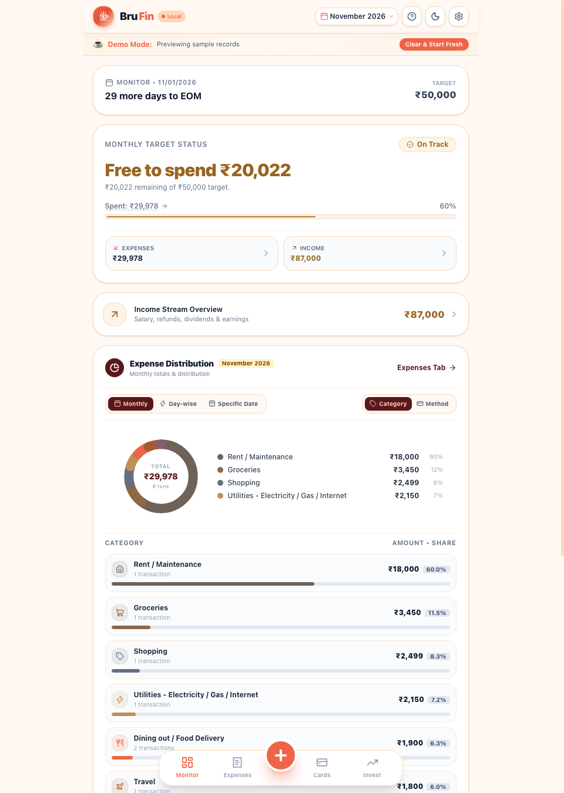
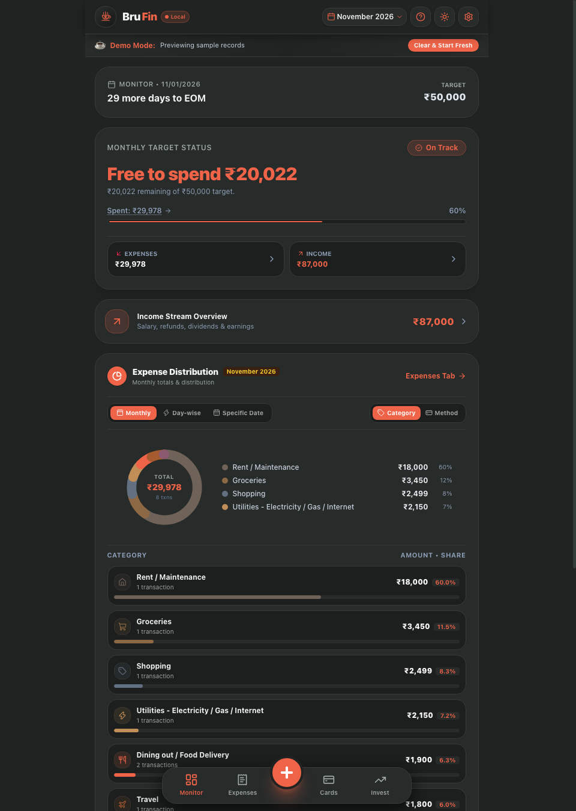

<div align="center">
  
  <h1>BruFin</h1>
  <p><strong>Brewing calmer finances.</strong><br />A private, local-first personal finance tracker for the web and Android.</p>
  <p>
    <a href="https://github.com/diamachi/BruFin/actions/workflows/android-apk.yml"></a>
  </p>
</div>

BruFin helps you track day-to-day spending and keep an eye on your wider financial picture. At startup, choose demo data, a standalone local database, or a self-hosted homelab server. In server mode, browser and Android clients share one data store and queue offline edits until the server is reachable again.

<p align="center">
  <a href="#screenshots">Screenshots</a> ·
  <a href="#features">Features</a> ·
  <a href="#privacy--data-storage">Privacy &amp; storage</a> ·
  <a href="#run-on-the-web">Run on the web</a> ·
  <a href="#build-for-android">Build for Android</a>
</p>

## Screenshots

Screenshots use BruFin's built-in sample data. The same dashboard is shown in both themes.

<div align="center">
  
  
</div>

<p align="center"><sub>Light theme · Dark theme</sub></p>

## Features

| Area | What you can do |
| --- | --- |
| **Dashboard** | Review monthly income, spending, budget remaining, category breakdown, balances, card activity, and loans. |
| **Transactions** | Record income and expenses with categories, dates, payment methods, notes, search, filters, and quick entry. |
| **Recurring bills** | Set monthly or split-payment schedules, see due dates, and post bills into expenses when paid. |
| **Balances** | Track opening and closing liquid balances by month, compare changes, and optionally enable balance prompts. |
| **Cards** | Manage credit cards, limits, statement dates, and card-linked spending. |
| **Investments & loans** | Keep a manual investment list, estimate returns, record loans, and explore the effect of extra repayments. |
| **Categories** | Add, remove, and restore default income and expense categories in Settings. Existing transactions keep their saved category label. |
| **Data tools** | Export JSON backups or transaction CSVs; import backups; preview older BruFin exports and restore only new transactions. |
| **Self-hosting** | Run the web dashboard and private SQLite API with Docker Compose; pair Android phones by scanning a short-lived QR shown by the connected server dashboard, then sync offline edits. |
| **Personalization** | Switch themes, adjust display scale, and optionally show compact storage and memory diagnostics. |
| **Demo mode** | Explore with sample records, then clear them and begin with an empty local database. |

Investment and loan figures are estimates based on values you enter. BruFin does not fetch live market, bank, or lender data.

## Privacy & data storage

By default, BruFin works locally without an account or server. Financial records are stored in IndexedDB (`brufin-local`, schema version 3); theme, display scale, and server connection preferences use `localStorage`. If you configure a self-hosted server, that server becomes the shared source of truth while IndexedDB remains each device's offline working copy.

- **Web:** IndexedDB is managed by the browser and scoped to the exact origin and browser profile. For example, `localhost`, a LAN IP address, and a deployed domain each have separate data. The browser controls the physical files; BruFin does not create a separate database file you can move directly.
- **Android:** IndexedDB is held in the app's private WebView data area for application ID `com.diamachi.brufin`. Android isolates that storage from other apps; it is not exposed as a normal document or standalone SQLite file.
- **Self-hosted mode:** The server keeps a SQLite database at `./data/brufin.sqlite3` in the Compose project directory. Clients communicate with the API; they do not connect directly to SQLite. The API token grants access to all stored BruFin data.
- **Backups:** Export a JSON backup regularly if you want a portable copy. Backups are unencrypted and contain financial records, so store them somewhere private. Clearing browser data or clearing/uninstalling the Android app can remove local records.

Browser storage is tied to the browser's origin and profile. IndexedDB is managed by each browser, and its on-disk location varies by browser and operating system; it is usually easiest to inspect it through that browser's developer tools. Android keeps WebView data in app-specific storage managed by the OS.

## Self-host BruFin

The Docker Compose deployment serves the BruFin dashboard and API on host port `8780` by default, with SQLite data persisted in `./data/`. Set `BRUFIN_HTTP_PORT` in `.env` to use another available host port; the container's internal API port remains `8080`.

```bash
cp .env.example .env
docker compose up -d --build
docker compose exec brufin cat /data/api-token
```

BruFin creates a random API token automatically on first start and stores it in the persistent data volume. For a fresh server on a private LAN/VPN, the server-hosted app can claim first-run setup once, so you normally do not need to retrieve or enter the token. The command above is still available for manual setup or if automatic claiming is disabled.

Open `http://<homelab-host>:8780` using its LAN/VPN address (or the host port you configured). Choose **Use my server with seamless sync** at startup, then select **Set up this server** in the server-hosted app. It claims the fresh server once and connects the dashboard. Then display the pairing QR from **Settings → Self-hosted server**. On Android, choose the same startup option and scan that QR. Each client keeps a local offline working copy; edits sync when the server returns. Concurrent edits to the same record are presented for review.

Automatic setup is intended for a private LAN/VPN: anyone who can reach a fresh, unclaimed server can claim it first. Do not expose the server publicly during setup; set `BRUFIN_ALLOW_FIRST_RUN_PAIRING=false` to disable this and require manual token entry. Keep the server on a private LAN/VPN or behind HTTPS. Do not publish the API directly over plain HTTP. The current self-hosted mode uses one shared access token for a single user.

See [SELF_HOSTING.md](SELF_HOSTING.md) for the combined Docker Compose and Portainer setup guide, including setup, backups, network access, and troubleshooting. The current release image is `diamachi/brufin:v0.6`; Portainer stores the database and token in a named Docker volume so they survive container replacement.

## Run on the web

### Requirements

- Node.js 20.19+ or 22.12+ (Vite requirement)
- npm, included with Node.js

### Start the development server

From the repository root:

```bash
npm ci
npm run dev
```

Open the address Vite prints (normally [http://localhost:5173](http://localhost:5173)). The dev server supports hot reload, and its data stays in IndexedDB for that origin.

### Build and preview

```bash
npm run typecheck
npm test
npm run build
npm run preview
```

The static production site is generated in `dist/`. Type checking and the production build are separate steps.

### Serve a portable build

To serve the already compiled `dist/` folder without Vite:

```bash
./run_portable.sh
```

This requires Python 3, serves only on this computer, and does not compile source or hot reload. Run `npm run build` again after changing source.

## Build for Android

### Requirements

- Node.js and npm as above
- JDK 21
- Android SDK Platform 36 and Android SDK Build-Tools installed through Android Studio's SDK Manager
- Android platform tools (`adb`) to install on a connected device

Set `JAVA_HOME` to JDK 21 and configure the Android SDK in `android/local.properties` or `ANDROID_HOME`. Then sync the web build and compile:

```bash
npm ci
npm run cap:sync
cd android
./gradlew assembleDebug
```

The debug APK is created at `android/app/build/outputs/apk/debug/app-debug.apk`. Install it on a connected device with:

```bash
adb install -r android/app/build/outputs/apk/debug/app-debug.apk
```

The `build_apk.sh` helper also builds the debug APK, but expects a local JDK at `./jdk/Contents/Home`; use the manual steps if JDK 21 is installed elsewhere.

To build a signed release APK locally, configure `BRUFIN_RELEASE_KEYSTORE_FILE`, `BRUFIN_RELEASE_KEYSTORE_PASSWORD`, `BRUFIN_RELEASE_KEY_ALIAS`, and `BRUFIN_RELEASE_KEY_PASSWORD` for the private BruFin release key, then run `./gradlew assembleRelease` from `android/`. Keep the keystore and credentials out of Git. The release APK is written to `android/app/build/outputs/apk/release/app-release.apk`.

## Continuous integration and releases

GitHub Actions checks the project and builds a debug APK on pushes and pull requests to `main`, and can be started manually from the Actions tab. The workflow runs type checking and the database/archive import tests, builds the web assets, syncs Capacitor, compiles the APK, and uploads `brufin-debug-apk` as a 14-day artifact.

Pushing a version tag such as `v0.6` runs the release workflow, which builds and publishes a release-signed APK when GitHub Actions is available. To build locally instead, set the four `BRUFIN_RELEASE_*` variables from your private `android/signing/local.env`, then run `./gradlew --no-daemon assembleRelease` from `android/`. The signed APK is written to `android/app/build/outputs/apk/release/app-release.apk`; upload it to the GitHub release page with the matching release notes.

For the Actions workflow, configure these repository secrets under **Settings → Secrets and variables → Actions**:

| Secret | Value |
| --- | --- |
| `BRUFIN_SIGNING_KEYSTORE_BASE64` | Base64-encoded `android/signing/brufin-release.p12` |
| `BRUFIN_SIGNING_STORE_PASSWORD` | `BRUFIN_RELEASE_KEYSTORE_PASSWORD` from your private `android/signing/local.env` |
| `BRUFIN_SIGNING_KEY_ALIAS` | `BRUFIN_RELEASE_KEY_ALIAS` from your private `android/signing/local.env` |
| `BRUFIN_SIGNING_KEY_PASSWORD` | `BRUFIN_RELEASE_KEY_PASSWORD` from your private `android/signing/local.env` |

The signing directory is ignored by Git and should remain private. The release description is written in `.github/release-notes/` for that tag, so users see a feature summary rather than an autogenerated list of source changes.

The signing key changed from the debug key used for v0.4. Before installing the first stable-signed release, export a BruFin JSON backup, uninstall the previous app, install the new APK, and import the backup. Android deletes the app's local data when it is uninstalled. Later releases signed with the same key can update normally.

## Useful commands

| Command | Purpose |
| --- | --- |
| `npm ci` | Install dependency versions from the lockfile |
| `npm run dev` | Run the web development server |
| `npm run typecheck` | Check TypeScript without emitting files |
| `npm test` | Check local database storage and historical JSON/CSV import |
| `npm run build` | Build the production web assets |
| `npm run preview` | Preview the production web build |
| `npm run cap:sync` | Build web assets and sync them into Android |
| `cd android && ./gradlew assembleDebug` | Compile the Android debug APK |

## Project structure

```text
src/
  components/      App views, forms, modals, navigation, and diagnostics
  data/            Demo data
  utils/           IndexedDB storage, archive import, categories, and date helpers
  App.tsx          App state and view composition
  types.ts         Data model types
android/           Capacitor Android project
public/            App icon and web manifest
screenshots/       Light and dark dashboard screenshots
```

## Built with

- React 19 and TypeScript
- Vite 8
- Tailwind CSS 4
- Capacitor 8 for Android
- Python 3 standard-library API and SQLite for self-hosted mode
- Lucide icons
