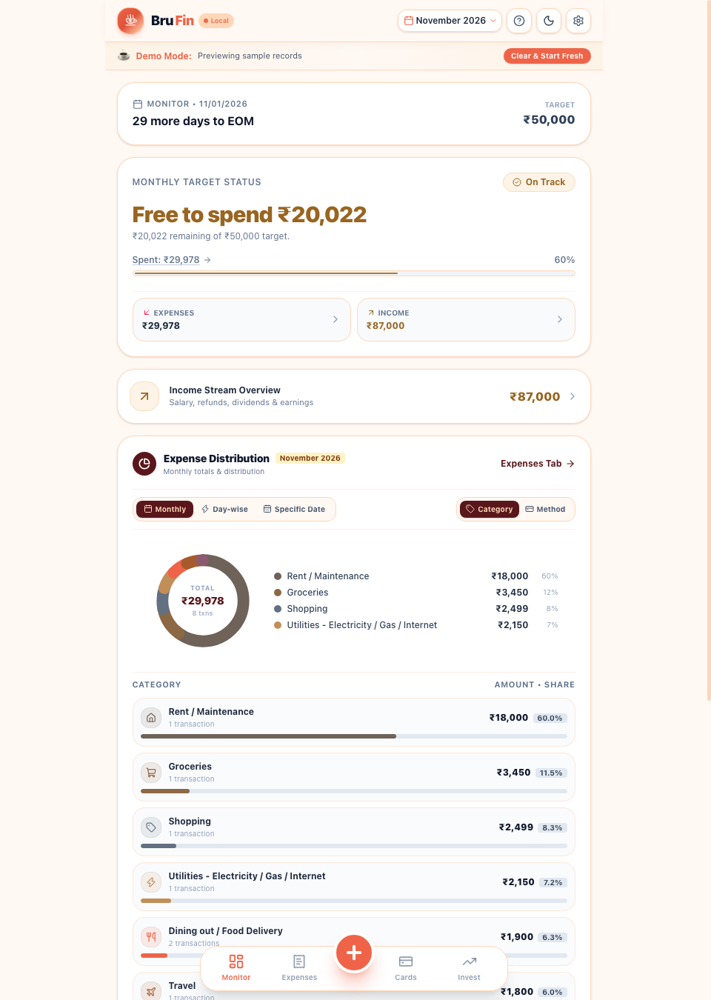
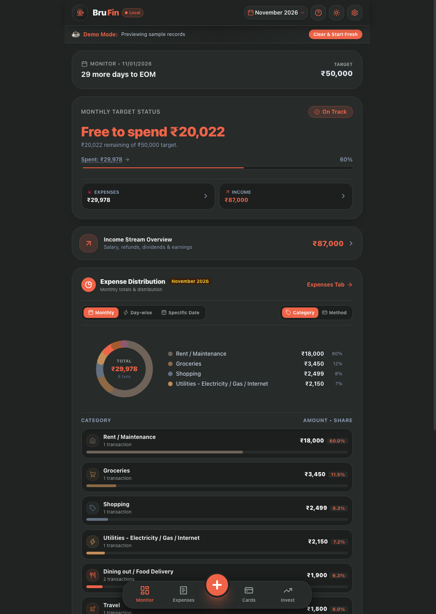

# BruFin

**Brewing calm finances.** BruFin is a local-first personal finance tracker built with React, TypeScript, Vite, and Capacitor. It runs as a web app and can be packaged as an Android app. Financial records stay in the browser or Android WebView on the device; there is no account, bank connection, or cloud service.

## Screenshots

The dashboard below uses synthetic demo records.

<p>
  
  
</p>

## Features

- **Monitor dashboard:** monthly spending target, remaining budget, income and expense totals, expense breakdown, balance snapshot, card spending, and loan overview.
- **Expense and income tracking:** quick entry, editable records, category and payment method selection, date and notes, recent description suggestions, search, and filters.
- **Recurring bills:** monthly and split-payment rules, due-day details, pending bill indicators, and manual posting into expenses.
- **Balances:** record monthly opening and closing liquid balances, review month-to-month changes, and optionally receive start- and end-of-month prompts.
- **Credit cards:** manage cards, limits, statement dates, and card-linked expense summaries.
- **Investments:** keep a manual list of mutual funds, fixed deposits, provident fund, and stocks; use the returns calculator for estimates.
- **Loans:** record loan details and explore estimated payoff time and interest savings from extra monthly payments.
- **Personalization:** light and dark themes, adjustable display scale, and an optional compact storage and memory monitor beside the BruFin title. Open either capsule to see full diagnostics; hide the monitor from the navbar or Settings.
- **Data portability:** export a JSON backup or transaction CSV, import a JSON backup, and preview older transaction data before restoring it. The archive viewer supports BruFin JSON archives, BruFin backup JSON, direct transaction arrays, and BruFin transaction CSV exports; it detects duplicates and restores only new entries.
- **Demo mode:** explore the app with sample data, then clear it to start a personal database.

## Privacy and data storage

BruFin has no application backend. Financial records are stored locally in IndexedDB for the current browser origin or Android app WebView. On first launch after this update, BruFin migrates existing records from its previous `localStorage` keys into IndexedDB, then removes those old copies after the migration commits. New and edited transactions are written by record ID, so each save does not rewrite the full transaction history. Browser storage is tied to the browser profile and origin: for example, `localhost` and a LAN IP address have separate data stores. Clearing browser or app data can remove records, so export a JSON backup regularly and keep that file somewhere safe. Backups are unencrypted and contain financial records; protect them accordingly.

The app does not connect to banks, fetch account balances, or sync records between devices. Browser storage can still be cleared by the user or operating system; keep a separate backup. Investment and loan calculations are estimates based on values entered by the user, not live market or lender data.

## Run locally for development

### Requirements

- Node.js compatible with the Vite version in `package-lock.json` (Node 20.19+ or 22.12+).
- npm, included with Node.js.

### Install and start

From the repository root:

```bash
npm ci
npm run typecheck
npm test
npm run dev
```

Vite prints the local address, normally [http://localhost:5173](http://localhost:5173). The development server enables hot reload. Data you enter is saved in IndexedDB for that browser origin.

To create and preview a production web build:

```bash
npm run build
npm run preview
```

The generated static site is written to `dist/`.

### Portable static server

After creating the web build with `npm run build`, you can serve the compiled `dist/` folder with Python:

```bash
./run_portable.sh
```

This serves the built app at [http://localhost:5173](http://localhost:5173) without running Vite. It does not compile source or provide hot reload; rebuild with `npm run build` after source changes. Python 3 is required. The server binds to this computer only.

## Build the Android app

### Requirements

- Node.js and npm as above.
- JDK 21.
- Android SDK with the platform and build tools required by this project (`compileSdkVersion` 36; install Android SDK Platform 36 and Android SDK Build-Tools in Android Studio's SDK Manager).
- Android platform tools (`adb`) to install the APK on a connected device.

Set `JAVA_HOME` to your JDK 21 installation and make sure the Android SDK is configured in `android/local.properties` or `ANDROID_HOME`. Then build and sync the web app into the Android project:

```bash
npm ci
npm run cap:sync
```

Compile the debug APK:

```bash
cd android
./gradlew assembleDebug
```

The APK is generated at `android/app/build/outputs/apk/debug/app-debug.apk`. Install it on a connected Android device with:

```bash
adb install -r android/app/build/outputs/apk/debug/app-debug.apk
```

The `build_apk.sh` helper performs these steps too, but expects a local JDK at `./jdk/Contents/Home`. The `jdk/` directory is ignored by Git; use the manual steps above if your JDK is installed elsewhere. This project is configured for a debug APK; release signing is not configured here.

GitHub Actions builds and verifies the debug APK for pushes and pull requests to `main`, and can also be started manually from the Actions tab. The workflow runs type checking and the database/archive import tests, builds the web assets, syncs Capacitor, compiles the APK, and uploads `brufin-debug-apk` as a 14-day artifact. Release signing is not configured.

## Useful commands

| Command | Purpose |
| --- | --- |
| `npm ci` | Install the exact dependency versions in the lockfile |
| `npm run dev` | Start the Vite development server |
| `npm run build` | Build the production web assets |
| `npm run typecheck` | Run the TypeScript compiler without emitting files |
| `npm test` | Verify local database migration and historical JSON/CSV import |
| `npm run preview` | Serve the production bundle locally |
| `npm run cap:sync` | Build web assets and sync them into the Android project |
| `cd android && ./gradlew assembleDebug` | Compile the Android debug APK |

The production build and type check are separate commands.

## Project layout

```text
src/
  components/      App views, forms, modals, navigation, and diagnostics
  data/            Demo data
  utils/           IndexedDB, legacy migration, archive import, categories, and date helpers
  App.tsx          App state and view composition
  types.ts         Data model types
android/           Capacitor Android project
public/            Web app icons and manifest
```

## Tech stack

- React 19 and TypeScript
- Vite 8
- Tailwind CSS 4
- Capacitor 8 for Android
- Lucide icons
